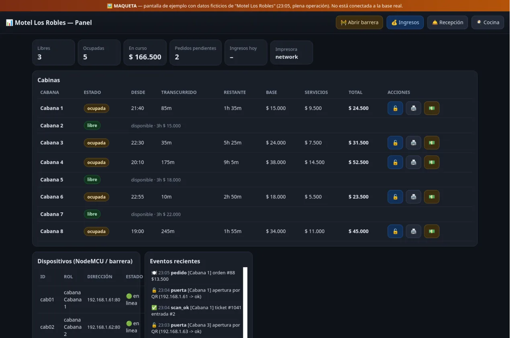
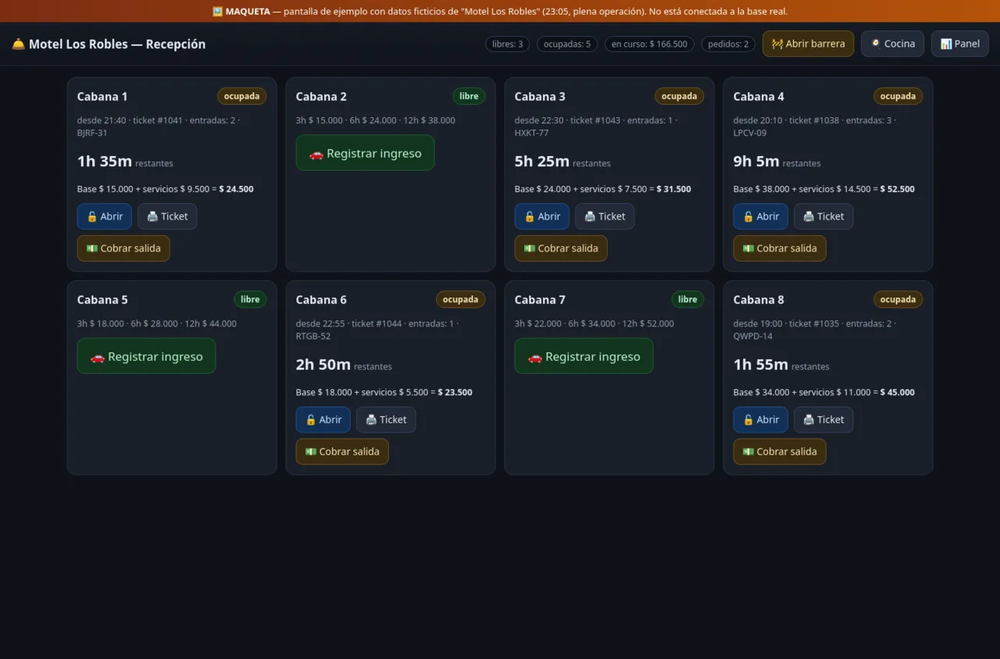
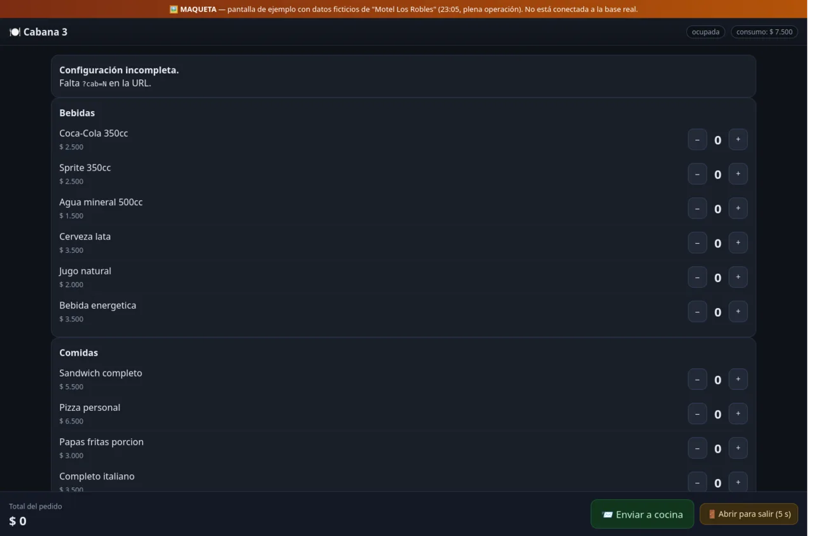
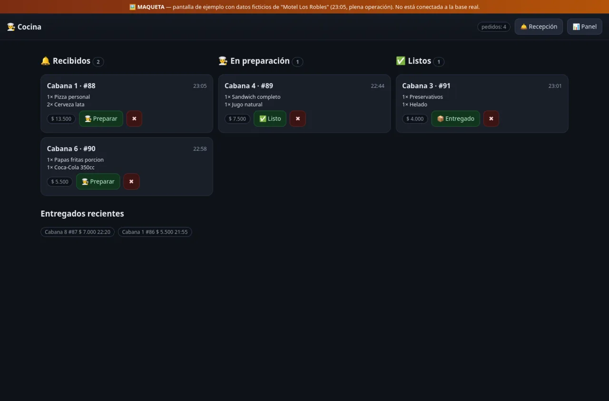
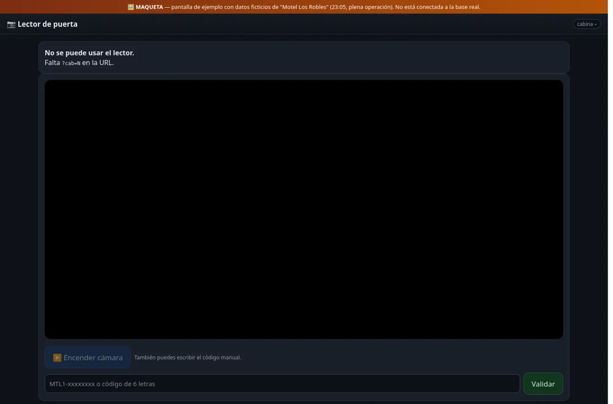
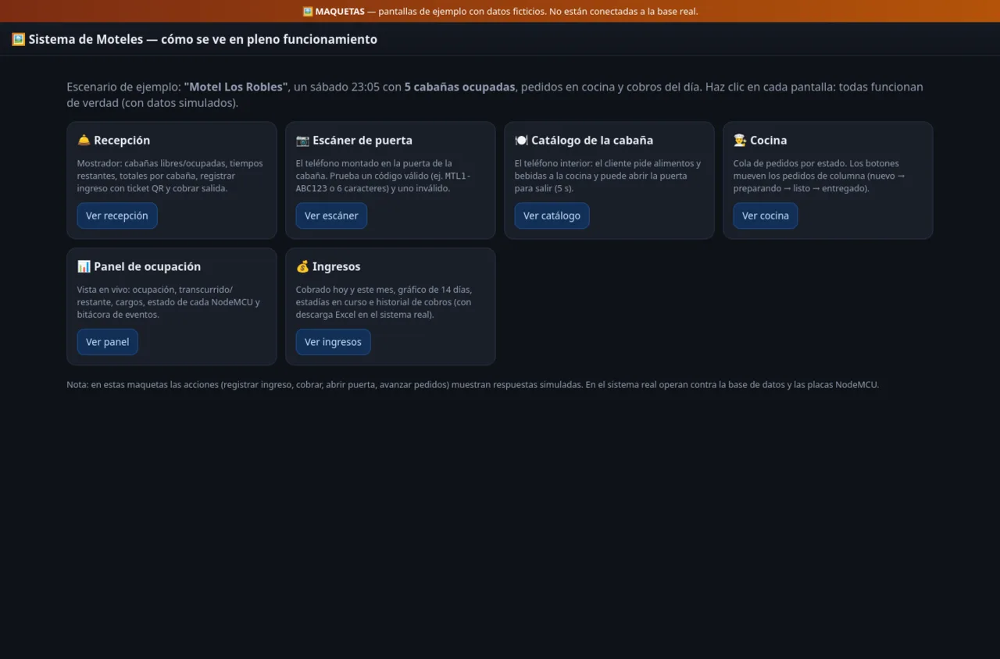

# Motel System

> Recepción, cabaña, cocina y administración conectadas por una intranet Flask, un ticket QR y un NodeMCU que controla la cerradura.



**Software & IA · operación presencial** · **7** vistas · **8** cabañas demo · **QR** con HMAC · **0** nube

## Qué es

Sistema de control de accesos y consumos para moteles: Flask + SQLite + ESP8266, ticket térmico, QR anti-replay y panel de ingresos.

Los datos y las cabañas son de demostración. Las claves reales, la base y los certificados no se publican: se reemplazan por archivos de ejemplo.

## El problema

### Una llave, un ticket y un consumo que debe cuadrar.

En un motel, la operación ocurre en segundos y en varios lugares a la vez. La intranet tiene que acompañar ese ritmo.

- Recepción registra la entrada, imprime un ticket y entrega una cabaña. La cabaña consume productos. Cocina prepara pedidos. Administración cierra la cuenta. Si cada paso vive en un papel o en una planilla distinta, el control se pierde.
- Motel System une esos puntos en una intranet local: Flask sirve las vistas, SQLite guarda el estado y un NodeMCU ESP8266 acciona la cerradura. El ticket lleva un QR firmado con HMAC-SHA256 para que no se pueda reutilizar.
- No depende de internet ni de una nube. La red local es el perímetro y el servidor es la fuente de verdad.

## Cómo funciona

### Del check-in al checkout, sin perder el hilo.

Cada vista tiene una responsabilidad y cada acción deja un registro.

1. **Recepción** — Registra huésped, cabaña y tarifa; emite el ticket con QR firmado.
2. **Cabina** — El QR se escanea en la cabaña; el servidor valida la firma y abre la puerta.
3. **Consumos** — La cabaña pide productos; cocina los prepara y el consumo se acumula a la cuenta.
4. **Panel** — Administración ve ocupación, ingresos, consumos y estado de cada cabaña.
5. **Checkout** — Se cierra la cuenta, se libera la cabaña y se registra el pago.

## Arquitectura

### Una intranet, tres frentes.

El servidor Flask coordina la base, la impresión y el control físico de la puerta.

`Recepción` (navegador) → `Flask` (app.py) → `SQLite` (estado) → `NodeMCU` (cerradura) → `Ticket` (ESC/POS)

- **QR con firma**: HMAC-SHA256 y ventana de validez para que un ticket no se reutilice.
- **Hardware simple**: Un ESP8266 con relé acciona la cerradura; el firmware está en PlatformIO.
- **Operación local**: Sin nube ni dependencias externas: la intranet vive en la red del recinto.

## Capturas



*Recepción: check-in y emisión de ticket.*



*Cabaña: consumos y estado.*



*Cocina: pedidos y preparación.*



*Escáner: validación del ticket.*



*Galería: productos y servicios.*


*Ingresos: cierre y métricas.*


*Panel: ocupación y administración.*

## Stack

Python, Flask, SQLite, ESP8266, PlatformIO, ESC/POS, HMAC-SHA256.

El servidor usa Flask y la biblioteca estándar; la base es SQLite y no requiere administración. El firmware del NodeMCU se compila con PlatformIO. La impresión térmica usa ESC/POS y el QR se firma en el servidor antes de imprimir.

## Instalación rápida

```bash
# 1. Crear la configuración local
cp config.example.json config.json
# Editar panel_key, rutas de certificados (si usás HTTPS) y printer.mode

# 2. Arrancar el servidor
python3 server/app.py
# Abrir http://127.0.0.1:8080

# 3. Prueba de humo
python3 smoke_test.py

# 4. Firmware (PlatformIO)
cd firmware/nodemcu_cabin
pio run
pio run -t upload
```

## Estructura del repositorio

```text
motel-system/
├── server/              # backend Python estándar + SQLite
│   ├── app.py           # rutas HTTP y API
│   ├── db.py            # esquema y consultas
│   ├── doorctl.py       # HMAC, anti-replay y control de puerta
│   └── printer.py       # ticket ESC/POS y QR
├── firmware/nodemcu_cabin/  # NodeMCU ESP8266 + relay
├── maquetas/            # planos y material de la maqueta
├── docs/                # página, datasheet y developer
├── config.example.json  # configuración sanitizada
└── README.md
```

## Límites y decisiones

- **Red local**: Está pensado para una intranet. Exponerlo a internet requiere VPN, TLS y autenticación adicional.
- **Datos demo**: La base incluye cabañas y usuarios de ejemplo; no hay datos de huéspedes reales.
- **Hardware**: La cerradura y la impresora son específicas. El repo documenta el protocolo, no vende el hardware.
- **Configuración**: Las claves reales se reemplazan por `x` en los ejemplos; hay que definirlas al desplegar.

## Preguntas frecuentes

**¿Funciona sin internet?**

Sí. La intranet y la base viven en la red local; el hardware también.

**¿Cómo se evita reutilizar un QR?**

El ticket se firma con HMAC-SHA256 y el servidor valida la firma y el estado antes de abrir.

**¿Qué hardware necesita?**

Un servidor Linux, un NodeMCU ESP8266 con relé y una impresora térmica ESC/POS.

**¿Puedo usarlo en producción?**

Es una base funcional. Antes hay que cambiar claves, TLS, respaldos y autenticación.


## Seguridad

No se publican la base `data/motel.db`, los tickets, los logs, los certificados ni el `config.json` real. El firmware usa `config.example.h` con placeholders. La puerta se abre con HMAC-SHA256 y ventana anti-replay; el secreto debe ser el mismo en servidor y firmware.


## Documentación

- [Datasheet](docs/datasheet.md): qué hace, cómo se usa y qué límites tiene.
- [Developer](docs/developer.md): arquitectura, archivos y puntos de extensión.
- [Página del proyecto](https://jmadasme.github.io/motel-system/): capturas, video y guía visual.

## Seguridad y datos

No se publican la base `data/motel.db`, los tickets, los logs, los certificados ni el `config.json` real. El firmware usa `config.example.h` con placeholders. La puerta se abre con HMAC-SHA256 y ventana anti-replay; el secreto debe ser el mismo en servidor y firmware.

Las claves, tokens y contraseñas de ejemplo se publican como `x`. Si vas a desplegar el proyecto, creá tus propios secretos y no los subas al repositorio.

## Licencia

MIT © jmadasme. El código se comparte para estudio y reutilización; los datos de terceros conservan sus propias licencias.
