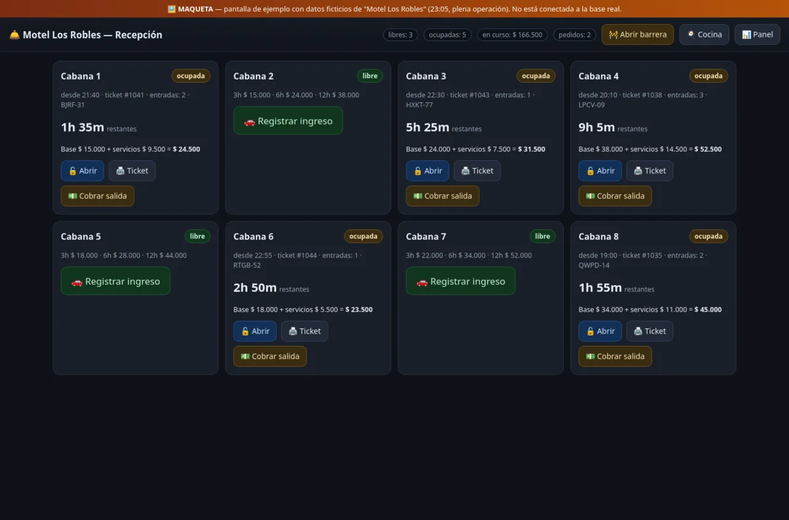
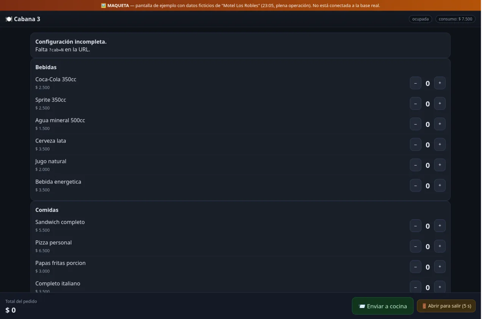
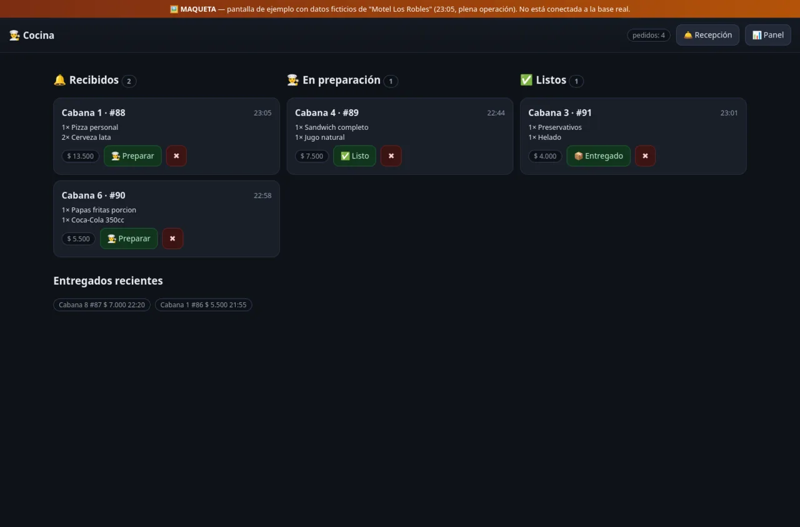
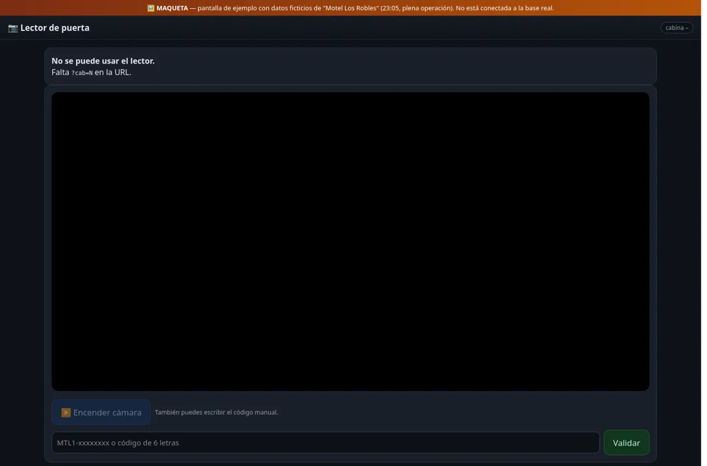
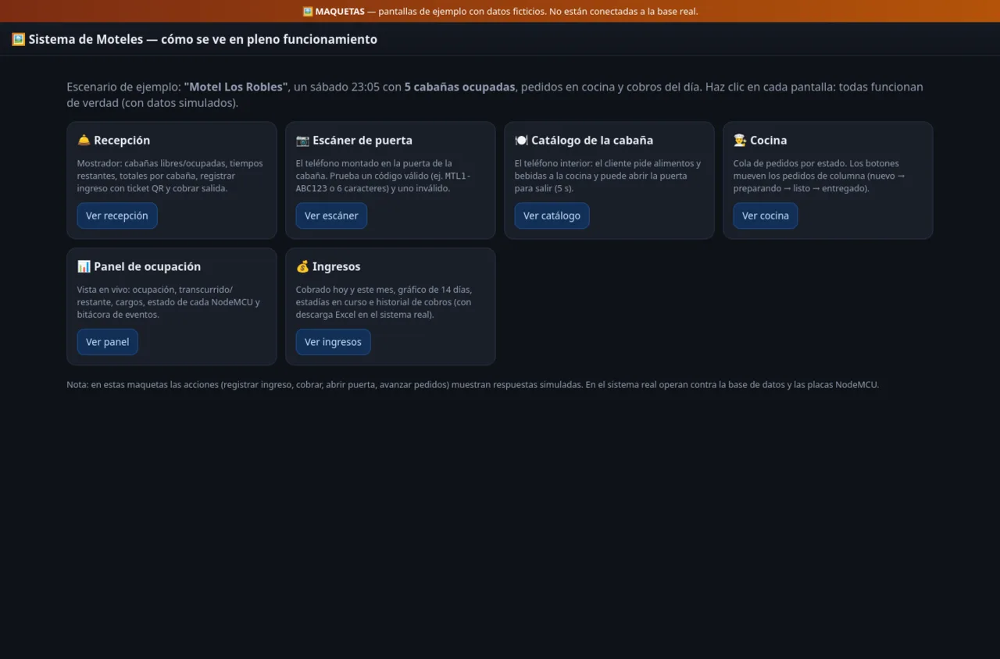
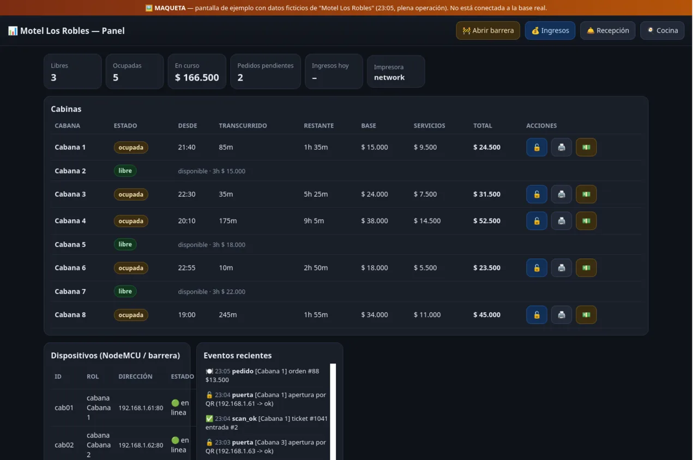

# Motel System · datasheet

**Software & IA · operación presencial**

Motel System — Recepción, cabaña, cocina y administración conectadas por una intranet Flask, un ticket QR y un NodeMCU que controla la cerradura.

## Ficha

| Métrica | Valor |
|---|---|
| 7 | vistas |
| 8 | cabañas demo |
| QR | con HMAC |
| 0 | nube |

## Qué resuelve

En un motel, la operación ocurre en segundos y en varios lugares a la vez. La intranet tiene que acompañar ese ritmo.

## Cómo se opera

1. **Recepción** — Registra ingreso, asigna cabaña y emite un ticket con QR.
2. **Escáner** — Lee el QR del ticket y valida el acceso sin escribir datos a mano.
3. **Cabaña** — Consulta consumo, tiempo restante y botón de apertura.
4. **Cocina** — Recibe pedidos de consumo y los marca en preparación.
5. **Panel** — Ve ingresos, ocupación y estado de las puertas.
6. **Checkout** — Cierra la estadía, calcula el total y libera la cabaña.

## Flujo técnico

| Etapa | Qué ocurre |
|---|---|
| Recepción | Registra huésped, cabaña y tarifa; emite el ticket con QR firmado. |
| Cabina | El QR se escanea en la cabaña; el servidor valida la firma y abre la puerta. |
| Consumos | La cabaña pide productos; cocina los prepara y el consumo se acumula a la cuenta. |
| Panel | Administración ve ocupación, ingresos, consumos y estado de cada cabaña. |
| Checkout | Se cierra la cuenta, se libera la cabaña y se registra el pago. |

## Capturas

*Recepción: check-in y emisión de ticket.*

*Cabaña: consumos y estado.*

*Cocina: pedidos y preparación.*

*Escáner: validación del ticket.*

*Galería: productos y servicios.*

*Ingresos: cierre y métricas.*

*Panel: ocupación y administración.*

## Límites

| Límite | Detalle |
|---|---|
| Red local | Está pensado para una intranet. Exponerlo a internet requiere VPN, TLS y autenticación adicional. |
| Datos demo | La base incluye cabañas y usuarios de ejemplo; no hay datos de huéspedes reales. |
| Hardware | La cerradura y la impresora son específicas. El repo documenta el protocolo, no vende el hardware. |
| Configuración | Las claves reales se reemplazan por `x` en los ejemplos; hay que definirlas al desplegar. |

## Preguntas frecuentes

**¿Funciona sin internet?**

Sí. La intranet y la base viven en la red local; el hardware también.

**¿Cómo se evita reutilizar un QR?**

El ticket se firma con HMAC-SHA256 y el servidor valida la firma y el estado antes de abrir.

**¿Qué hardware necesita?**

Un servidor Linux, un NodeMCU ESP8266 con relé y una impresora térmica ESC/POS.

**¿Puedo usarlo en producción?**

Es una base funcional. Antes hay que cambiar claves, TLS, respaldos y autenticación.

## Seguridad

No se publican la base `data/motel.db`, los tickets, los logs, los certificados ni el `config.json` real. El firmware usa `config.example.h` con placeholders. La puerta se abre con HMAC-SHA256 y ventana anti-replay; el secreto debe ser el mismo en servidor y firmware.

## Enlaces

- [README](../README.md)
- [Developer](developer.md)
- [Página del proyecto](https://jmadasme.github.io/motel-system/)
